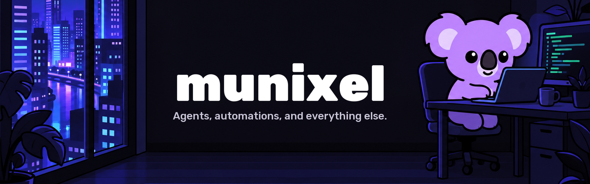

  

  <a href="https://www.youtube.com/@munixel"><b>YouTube</b></a>

 

**Munixel** is a Turkish YouTube channel about AI systems that actually run: agents, automations, memory, and the tools around them. Every video is a real test. What works, what breaks, and what it costs.

The videos are in Turkish. This is where the files behind them will live, so you can rerun the experiments yourself.

## Start here

<table>
  <tr>
    <td width="50%" valign="top">
      01 / WATCH
      <h3><a href="https://www.youtube.com/@munixel">Munixel on YouTube</a></h3>
      
Hands-on tests of AI models, agents and automations, for people who already use AI and want to go further.

      
<a href="https://www.youtube.com/@munixel"><b>Watch the tests →</b></a>

    </td>
    <td width="50%" valign="top">
      02 / THE RULE
      <h3>Nothing untested</h3>
      
If it wasn't tried, it doesn't get said. Limits, costs and failures are shown on screen, not left out.

    </td>
  </tr>
  <tr>
    <td width="50%" valign="top">
      03 / WHAT GETS TESTED
      <h3>Systems, not tips</h3>
      
Multi-session workflows, agents that run on a server, memory that survives the session, and side-by-side model comparisons.

    </td>
    <td width="50%" valign="top">
      04 / COMING HERE
      <h3>Experiment files</h3>
      
Prompts, configs and measurement tables from each video, published as the videos go live.

    </td>
  </tr>
</table>

 

---

  <b>Build. Test. Measure. Show what broke.</b>

